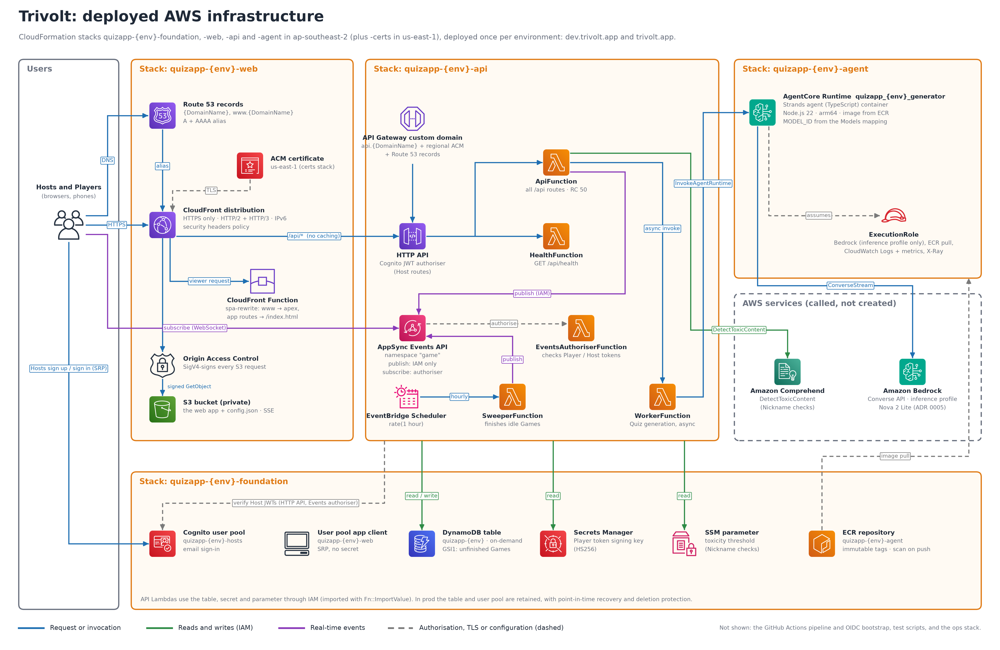

# Trivolt

A live trivia game. A Host generates a Quiz with AI, reviews it, and runs a Game in real time while Players answer on their own devices. It runs on AWS serverless services in ap-southeast-2.

The blog post [Building a multiplayer quiz game with AI using AWS serverless](https://builder.aws.com/content/3AuMiRkQdjCeiZqtieVsNcrQ2Pr/building-a-multiplayer-quiz-game-with-ai-using-aws-serverless) describes how it was built.



- [`GLOSSARY.md`](./GLOSSARY.md): the domain language. Code uses these terms exactly.
- [`docs/PRD.md`](./docs/PRD.md): requirements
- [`docs/PLAN.md`](./docs/PLAN.md): architecture and milestones
- [`docs/adr/`](./docs/adr/): architectural decisions
- [`grill_output/`](./grill_output/): transcripts of the AI-assisted design sessions, one per part
- Infrastructure diagrams, one per stack (the overview is below): [foundation](./foundation-infra.png), [api](./api-infra.png), [agent](./agent-infra.png), [web](./web-infra.png)

## Layout

| Path                 | What                                                                |
| -------------------- | ------------------------------------------------------------------- |
| `packages/domain`    | Pure Game rules: no I/O, no AWS SDK                                 |
| `packages/contracts` | Shared zod schemas for the HTTP API, events and agent I/O           |
| `packages/api`       | Lambda handlers                                                     |
| `packages/agent`     | The Strands generation agent (AgentCore Runtime container)          |
| `packages/web`       | React SPA                                                           |
| `infra/`             | CloudFormation templates (SAM transform where Lambdas are packaged) |

## Local development

You need Node 22 or later. pnpm is provided by corepack, so you don't install it separately.

```sh
corepack enable
pnpm install
pnpm test          # vitest across all packages
pnpm typecheck     # tsc -b
pnpm lint
pnpm format:check
pnpm --filter @quizapp/web dev
```

To lint the templates, you also need cfn-lint (`pip install cfn-lint`). Then run `pnpm lint:infra`.

## Using the app (dev)

1. Open the app URL (the **web** job prints it, or see the `quizapp-dev-web` stack's `Url` output).
2. **Host:** choose _Host a game_, sign up with your email, and confirm it with the code Cognito sends. Host sign-up and sign-in work only from New Zealand (see [Host sign-in firewall](#host-sign-in-firewall)).
3. Choose **New quiz**, give it a Topic, and wait about a minute while it's written and fact-checked. Review the Draft: discard or regenerate Questions, adjust Time Limits, then **Approve**. Each Host gets 20 generations a day. Choose **Delete** on any Quiz in the list to remove it, whatever its status. Past games are kept.
4. Start a game from a Ready Quiz. The Lobby shows the Join Code, the Join Link, and a QR code of the Join Link that Players can scan from across the room.
5. **Players:** scan the QR code or open the Join Link (or _/play_ plus the code) on phones, pick a Nickname, and play.
6. **Host:** to end a Game early, choose **Cancel game**. Players see the scores so far, and the Game is kept in Past games as abandoned.

To work on the web app locally against dev:

```sh
QUIZAPP_DEV_URL=https://<the dev CloudFront domain> corepack pnpm --filter @quizapp/web dev
```

## Deploying

The **dev** environment is AWS account `587736032611`, reached through the `quizdash` CLI profile. That profile has no default region, so every command passes `--region ap-southeast-2`. The prod account is not yet decided.

Every push to `main` runs `.github/workflows/deploy.yml`, which deploys to dev. Pushing a `v*` tag runs `.github/workflows/deploy-prod.yml`, which waits for approval, then deploys prod the same way. Both call `.github/workflows/deploy-env.yml`:

1. **CI**: format, lint, typecheck, tests, and the web build.
2. **foundation**: the `quizapp-dev-foundation` stack.
3. **agent-image**: bundles the agent and pushes an arm64 image to ECR, tagged with the commit SHA.
4. **agent**: the `quizapp-dev-agent` stack, then a smoke test that invokes the agent and expects "Canberra" in the reply (Spike A).
5. **api**: the `quizapp-dev-api` stack (HTTP API, the API Lambda, AppSync Events). This runs in parallel with steps 3 and 4.
6. **smoke**: plays a whole Game against dev over HTTP and AppSync Events.
7. **ops**: the `quizapp-{env}-ops` stack (alarms and a budget alert, emailed to `ALERT_EMAIL`), only when the GitHub Environment has an `ALERT_EMAIL` secret.
8. **certs**: the `quizapp-dev-certs` stack in **us-east-1**, the website's certificate (CloudFront only accepts certificates from there). This runs in parallel with the others.
9. **web**: the `quizapp-dev-web` stack (S3 and CloudFront), then the app itself. The job prints the app's URL, then checks the site and the `www.` redirect.

Each environment's domain and Route 53 hosted zone are in `infra/params/{env}.json`. Dev is served at `https://dev.trivolt.app`, with `www.dev.trivolt.app` redirecting to it, and its API also at `https://api.dev.trivolt.app`. Prod gets `trivolt.app`. An empty `DomainName` deploys without a custom domain.

You can also run it from the Actions tab (**Deploy → Run workflow**).

### One-time setup

**1. Bootstrap the account (by hand, with admin credentials):**

```sh
aws cloudformation deploy --profile quizdash --region ap-southeast-2 \
  --stack-name quizapp-dev-bootstrap \
  --template-file infra/bootstrap/github-oidc.yaml \
  --capabilities CAPABILITY_NAMED_IAM \
  --parameter-overrides Env=dev GitHubRepository=cirruscape/public-app-trivolt \
    GitHubSubjectPrefix=repo:cirruscape@235645298/public-app-trivolt@1432826993
```

`GitHubSubjectPrefix` must match the start of the OIDC `sub` claim GitHub sends. This repo uses GitHub's immutable subject format, which includes the owner and repo names and IDs. Look it up with `curl -s https://api.github.com/repos/cirruscape/public-app-trivolt/actions/oidc/customization/sub` (`sub_claim_prefix`). For a repo using the classic format, leave the parameter out. Renaming the repo changes the claim, so re-run this bootstrap with the new name or GitHub deploys fail with "Not authorized to perform sts:AssumeRoleWithWebIdentity".

The GitHub OIDC provider exists only once per AWS account. If the account already has one, add `CreateOidcProvider=false ExistingOidcProviderArn=<arn>`.

**2. Create a GitHub Environment named `dev`** (Settings → Environments). Add these variables, copied from the bootstrap stack's outputs:

| Variable                 | Bootstrap output      |
| ------------------------ | --------------------- |
| `AWS_DEPLOY_ROLE_ARN`    | `DeployRoleArn`       |
| `CFN_EXECUTION_ROLE_ARN` | `CfnExecutionRoleArn` |
| `ARTIFACTS_BUCKET`       | `ArtifactsBucketName` |

The deploy role trusts only jobs that run in this Environment.

**3. Bedrock model access.** The agent currently uses **Amazon Nova 2 Lite**, through the global inference profile `global.amazon.nova-2-lite-v1:0`, because the account doesn't have Anthropic access yet. The intended model is Claude Opus 5.5 (`au.anthropic.claude-opus-5-5`). To switch, edit the environment's `ModelId` and `FoundationModelId` in the `Models` mapping at the top of `infra/agent.yaml`, then push. No code change is needed (ADR 0005). Don't make the model a stack parameter: `aws cloudformation deploy` keeps a parameter's previous value, so a changed default never reaches an existing stack.

### Prod (one-time setup)

Prod shares the dev account, with its own stacks, roles and GitHub Environment.

**1. Bootstrap prod** (the account's GitHub OIDC provider already exists, from dev):

```sh
aws cloudformation deploy --profile quizdash --region ap-southeast-2 \
  --stack-name quizapp-prod-bootstrap \
  --template-file infra/bootstrap/github-oidc.yaml \
  --capabilities CAPABILITY_NAMED_IAM \
  --parameter-overrides Env=prod GitHubRepository=cirruscape/public-app-trivolt \
    GitHubSubjectPrefix=repo:cirruscape@235645298/public-app-trivolt@1432826993 \
    CreateOidcProvider=false \
    ExistingOidcProviderArn=arn:aws:iam::587736032611:oidc-provider/token.actions.githubusercontent.com
```

**2. GitHub Environments** (Settings → Environments):

- **`prod`:** the three variables from the prod bootstrap stack's outputs, as for dev, plus an **Environment secret** (not a variable) named `ALERT_EMAIL`. Variables are printed in the public Actions logs; secrets are masked. Under **Deployment branches and tags**, allow only tags matching `v*`.
- **`prod-approval`:** no variables. Add yourself under **Required reviewers**.

**3. Confirm the alert subscription:** the first prod deploy sends an AWS confirmation email to `ALERT_EMAIL`. Alarms aren't emailed until you confirm it.

**4. Activate the cost allocation tag:** in Billing → Cost allocation tags, activate `quizapp-env`. It appears up to 24 hours after the first tagged deploy. The budget counts nothing until then.

**To deploy prod:** `git tag v1.0.0 && git push origin v1.0.0`, then approve the run in the Actions tab. Prod is served at `https://trivolt.app`.

### Manual deploys

These are useful when debugging a stack outside the pipeline.

```sh
# Foundation
aws cloudformation deploy --profile quizdash --region ap-southeast-2 \
  --stack-name quizapp-dev-foundation \
  --template-file infra/foundation.yaml \
  --capabilities CAPABILITY_AUTO_EXPAND \
  --parameter-overrides Env=dev

# API (HTTP API, Lambdas, AppSync Events)
pnpm --filter @quizapp/api bundle
sam deploy --profile quizdash --region ap-southeast-2 \
  --template-file infra/api.yaml \
  --stack-name quizapp-dev-api \
  --resolve-s3 --capabilities CAPABILITY_IAM \
  --parameter-overrides Env=dev DomainName=dev.trivolt.app HostedZoneId=Z00841461JB6KK1GON7XJ
```

Pass the domain values from `infra/params/dev.json` on every manual deploy of the api and web stacks, so the stack never keeps stale values or drops the custom domain.

### Observability

- **Traces:** the agent image includes AWS Distro for OpenTelemetry (ADOT) and exports spans to AgentCore Observability (CloudWatch → GenAI Observability). Each generation is one trace, grouped by AgentCore session, with spans for the _Quiz writer_ and _Fact checker_ agents. The invocation span carries `quiz.*` counts, and each rejected Question is a `question.rejected` span event with the reason.
- **Metrics:** the worker publishes `QuestionsRequested`, `QuestionsReturned`, `QuestionsMalformed` and `QuestionsFailedCheck` to the `QuizApp` CloudWatch namespace, per `Env`.

New spans can take several minutes to appear in the Observability views.

### Host sign-in firewall

A WAF web ACL, `quizapp-{env}-hosts` in the foundation stack, filters the Cognito user pool's public endpoints: sign-up, confirmation, sign-in and password reset. It blocks:

- requests from outside New Zealand
- IPs on AWS's reputation and anonymous-IP lists (botnets, VPNs, Tor, proxies and hosting providers)
- more than 100 requests from one IP in 5 minutes
- known bad inputs and common exploits (the AWS core rule set)

A blocked Host sees an "Unauthorised" message asking them to email support@cirruscape.com to request access. Blocked requests are logged to the `aws-waf-logs-quizapp-{env}-hosts` log group, kept for 30 days. IAM-signed Admin API calls bypass WAF, so `seed` and `smoke` work from anywhere. Players don't use Cognito, so joining a Game works from anywhere.

### Seeding and the smoke test

```sh
# Give a Host (who has signed up) the sample Ready Quiz, for a quick Game without generating one.
AWS_PROFILE=quizdash corepack pnpm --filter @quizapp/scripts seed -- you@example.com

# Play a whole Game against dev (a test Host and three bot Players, over HTTP and AppSync Events),
# then generate, approve and delete a real Quiz.
AWS_PROFILE=quizdash corepack pnpm --filter @quizapp/scripts smoke

# Quality check for the generation agent: 15 Topics through the deployed agent. Costs model
# usage; needs credentials allowed to invoke the runtime (the pipeline's deploy role can).
corepack pnpm --filter @quizapp/scripts eval
```

The sample Quiz (`seed`) is still useful for a quick Game without waiting for generation.

The agent stack needs an image in ECR, so deploy it through the pipeline. Building the image locally requires Docker with arm64 support.
